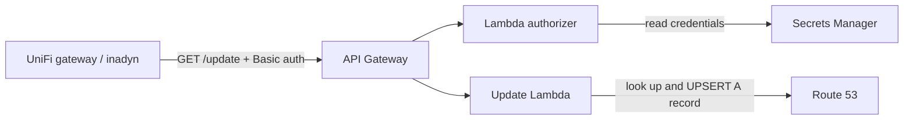

# Serverless dynamic DNS for UniFi on Route 53

[](https://github.com/ohallord/unifi-route53-ddns-serverless/actions/workflows/ci.yml) [](LICENSE)   

A No-IP-compatible update endpoint on API Gateway and Lambda that keeps a Route 53 `A` record pointed at your home IP. UniFi gateways (UDM, UDM Pro, UDR, UCG, USG) can use it from the built-in Dynamic DNS settings, and so can any other `inadyn` client.

## Why I built this

My home IP changes now and then, and my domain already lives in Route 53. I didn't want to pay for a DDNS subscription or run a script or container on my network just to update one record. The UniFi gateway already knows how to talk to No-IP, so I wrote a small endpoint that speaks the same protocol and updates Route 53 directly.

## How it works



When the gateway sees its WAN IP change, it sends a No-IP style `GET` request with Basic auth. A Lambda authorizer checks the credentials against Secrets Manager. The update function then confirms the hostname is the one configured at deploy time and that the IP is valid IPv4. It reads the current record and only calls Route 53 if the IP has changed. It replies with the codes the gateway expects: `good`, `nochg`, `nohost`, `badreq`, `badagent` or `911`.

## Quick start

You need Node.js, the Serverless Framework CLI (v4), the AWS CLI with credentials, and a public hosted zone for your domain in the same account.

```bash
npm install -g serverless

serverless deploy \
  --param="hostName=home.example.com" \
  --param="ddnsUsername=your_username"

# Get the generated password
aws secretsmanager get-secret-value \
  --secret-id /ddns/aws-python-ddns/dev \
  --query SecretString --output text
```

`hostName` must be lowercase, fully qualified, and have no trailing dot. The deploy prints the API Gateway URL you'll need in the next step.

## Configure your UniFi gateway

In the UniFi Network application, go to **Settings > Internet > (your WAN) > Dynamic DNS** and add an entry:

| Field | Value |
|---|---|
| Service | `noip` |
| Hostname | The `hostName` you deployed with |
| Username | The `ddnsUsername` you deployed with |
| Password | The generated password |
| Server | Your endpoint without `https://`, for example `abc123defg.execute-api.us-east-1.amazonaws.com/dev/update` |

## Using inadyn directly

```ini
custom https://YOUR_API_GATEWAY_ENDPOINT {
    hostname = "your.example.com"
    username = "your_username"
    password = "your_password"
    ddns-server = "YOUR_API_GATEWAY_ENDPOINT"
    ddns-path = "/dev/update?hostname=%h&myip=%i"
}
```

`YOUR_API_GATEWAY_ENDPOINT` is the domain only, for example `abc123defg.execute-api.us-east-1.amazonaws.com`. `%h` and `%i` are inadyn's hostname and IP variables.

## Testing with curl

```bash
curl -v \
  -H "Authorization: Basic $(echo -n 'your_username:your_password' | base64)" \
  -H "User-Agent: test/1.0" \
  "https://YOUR_API_GATEWAY_ID.execute-api.YOUR_REGION.amazonaws.com/dev/update?hostname=home.example.com&myip=192.0.2.1"
```

You should get `good 192.0.2.1` on a change or `nochg 192.0.2.1` if the record already matches.

## Design notes

Most of the work went into keeping a public endpoint from becoming a way to change DNS records.

### One record only

The function refuses any hostname except the one set at deploy time and returns `nohost`. The IAM role enforces the same limit on its own: it can only `UPSERT` an `A` record with that exact name. A bug in the code still couldn't touch other records in the zone.

### No password in the template

Secrets Manager generates a 32-character password during the first deploy. It never appears in `serverless.yml`, the CloudFormation template or the deployment bucket. Later deploys don't regenerate it. To use your own password, run `aws secretsmanager put-secret-value` against the same secret.

### Auth runs before the update code

A Lambda authorizer checks credentials with a constant-time comparison and returns `401` on failure. It caches results for 5 minutes, so a password change can take that long to take effect. The cached policy covers the whole stage, so a cached allow still works on any path.

### Logging

Full request events are never logged, so credentials stay out of CloudWatch. Logs are kept for 30 days.

### Zone matching

The function finds the hosted zone by the longest match on a label boundary, skipping private zones. That way `badexample.com` can never match `example.com`.

### No unnecessary writes

It reads the current record and skips the Route 53 change if the IP is already correct.

## Known limits

- Only IPv4 `A` records are supported. There's no IPv6 (`AAAA`) support.
- Each deployment updates one hostname. For more names, deploy more stages.
- If `myip` is missing, the caller's source IP is used.
- Anyone who has the URL can try to log in. Use the generated password, and consider [API Gateway throttling](https://docs.aws.amazon.com/apigateway/latest/developerguide/api-gateway-request-throttling.html) or AWS WAF rate limiting.
- The record TTL is fixed at 300 seconds.
- The default region in `serverless.yml` is `us-east-1`. Change it there if you need to.

## Upgrading from an earlier version

Earlier versions took `ddnsPassword` as a deploy parameter, which left it in plain text in the CloudFormation template. The first deploy of this version replaces it with a generated password. Retrieve the new one and update your gateway. The `ddnsPassword` parameter is no longer used.

## Development

```bash
python -m venv .venv && . .venv/bin/activate
pip install -r requirements-dev.txt
pytest && ruff check .
```

CI runs the same checks on every push to `main`.

## Removing it

```bash
serverless remove
```

This deletes the stack, including the Lambda functions, API Gateway and the secret.

## Reporting a vulnerability

See [SECURITY.md](SECURITY.md).

## Credits

Protocol compatibility is based on [inadyn](https://github.com/troglobit/inadyn) and its [custom provider docs](https://github.com/troglobit/inadyn?tab=readme-ov-file#custom-ddns-providers).
